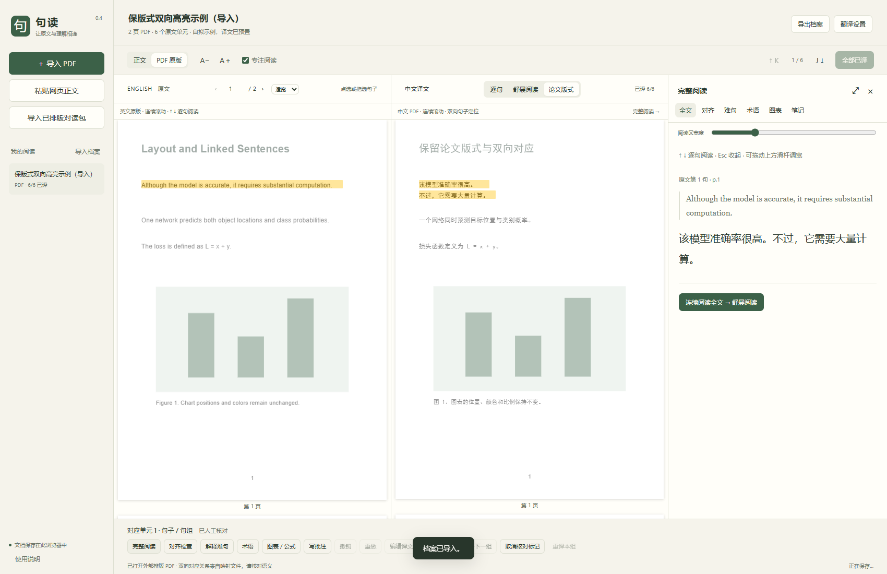

# 句读 · Sentence Reader

**让原文与理解相连。** 一个在本机运行的双语论文阅读器：点击英文或中文，另一侧同步高亮；按方向键，一句一句读下去。

[下载版本](https://github.com/AnderroleWang/sentence-reader/releases) · [反馈问题](https://github.com/AnderroleWang/sentence-reader/issues) · [MIT 许可证](LICENSE)

适合这样的时刻：英文和译文都在眼前，却总要来回寻找对应位置；或者每个单词都认识，整句仍然读不懂。



> 当前版本：**v0.4.3，实验版**。支持可选中文字的 PDF 和粘贴的网页正文。阅读、定位、笔记在本机完成；翻译和难句解释使用你自行配置的服务。

## 先体验，再配置

### Windows：便携包

1. 在 [Releases](https://github.com/AnderroleWang/sentence-reader/releases) 下载 `sentence-reader-v0.4.3-windows-x64.zip`，**解压整个文件夹**。
2. 双击文件夹里的 **`start.cmd`**，保持启动窗口运行。
3. 浏览器自动打开 <http://127.0.0.1:8765/>。首次可直接读自带的双语演示，**不需要密钥**。
4. 要读自己的论文，导入 PDF，打开右上角“翻译设置”，填写自己的服务地址、模型和密钥。

便携包自带官方 Python 运行环境，面向 **Windows 10/11 x64**；无需管理员权限、pip、npm 或额外安装 Python。不要在压缩包中直接运行，也不要只复制启动文件。建议使用近期版 Edge 或 Chrome。

### 源码版：Windows / macOS / Linux

需要 **Python 3.9+** 和近期版浏览器，无需安装 Python 第三方依赖。

```bash
git clone https://github.com/AnderroleWang/sentence-reader.git
cd sentence-reader
python -X utf8 server.py
```

macOS / Linux 通常使用 `python3 -X utf8 server.py`，也可运行 `sh start.sh`。Windows 可在安装 Python 后双击 `start.cmd`。不要直接打开 `index.html`。

已经启动过时，启动器优先打开原地址，保留同一浏览器里的论文库。端口被其他程序占用时会尝试后续端口。按 `Ctrl+C` 停止服务。

## 怎样读得更轻松

| 你想做的事 | 操作与效果 |
| --- | --- |
| 只关注眼前这一句 | 开启“专注阅读”，点击任一侧；对应句子同时突出，其他内容变淡，包括 PDF 原页。 |
| 持续往下读 | `↓` / `→` / `J` 下一句；`↑` / `←` / `K` 上一句，两侧自动滚动定位。句组不会重复停留。 |
| 看完整长译文 | “完整阅读”侧栏可调宽、放大；“舒展阅读”连续显示全部译文。版式预览放不下时可自动打开完整阅读。 |
| 保留论文外观 | 英文 PDF 连续滚动；中文可用实验性“论文版式”，也可导入已有中文 PDF 和对应坐标，保留真实版式。 |
| 纠正错配或漏译 | “对齐检查”查看提示，重新配对、互换译文、合并或拆分句组；修改可撤销。 |
| 看懂难句 | “解释难句”结合前后文解释句子结构、术语和作者含义，每项附可定位的原文引句。 |
| 管理专业术语 | 悬停查看释义；自定义全文译法，保存、导入和导出个人词库。 |
| 查看图表与公式 | 点击 `Fig. 3` / `Eq. (5)` 等引用，展开原页预览；关闭后接着读当前句。 |
| 为综述或复现做准备 | 任一语言侧写批注；导出笔记同时带上原句、译文、页码和自己的想法。 |

方向键在输入框、编辑窗口和输入法组合输入时保留正常行为。`Esc` 收起阅读区 / 弹窗；`Ctrl+Z` 撤销，`Ctrl+Shift+Z` 重做。编辑框内仍使用正常的文字撤销。

**可以边翻译边阅读。** 翻译请求等待期间，上下键、双侧句子点选和 PDF 页码跳转照常使用；批次结果写入会保留当前句子和手动滚动位置。翻译期间暂停改写原文、合并拆分、重译和切换文档，避免覆盖正在处理的内容。

## 不靠中英文标点猜对应

英文一句可能翻译成中文两句，中文内部也可能调整语序。句读先为原文建立固定编号，再让模型按编号返回译文：

```json
{
  "source_ids": ["s000017"],
  "translation": "该模型准确率很高。不过，它需要大量计算。"
}
```

一段译文可以包含多句中文；必要时，相邻多个原文单元也可以对应同一译文组。程序检查编号覆盖、唯一性和顺序；格式错误时要求模型纠正一次，仍失败则保留先前成功批次。

**编号正确不代表翻译语义一定正确。** 检查提示是核对入口；你可以人工重配、合并、拆分并撤销。只有亲自确认的内容才标为“已人工核对”。

## 接入自己的翻译服务

| 服务 | 协议 | 地址示例 | 模型与密钥 |
| --- | --- | --- | --- |
| 常见兼容接口 | 兼容 Chat Completions | 服务方提供的 `https://api.example.com/v1` 或完整 `/chat/completions` 地址 | 填服务方的模型名与自己的 API 密钥 |
| 本地 Ollama | Ollama 原生接口 | `http://127.0.0.1:11434` | 填已安装的模型名，密钥通常留空 |

地址仅为示例，程序不提供付费账号或额度。模型需要稳定输出 JSON。小模型可先把每批原文数调为 4。测试连接也会产生一次模型请求；单次最多等待 180 秒，自动纠正可能再请求一次。

**选择模型**：先填服务地址与密钥，点“读取模型列表”，搜索后从下拉框选择即可。支持兼容服务的 `/models`、Ollama 本机模型列表及 OpenCode 目录；服务不提供列表时仍可手动输入，读取失败不会清空原模型。读取仅查询目录，不发送论文或调用翻译；列表不等于模型已获授权或一定支持 Chat Completions，可再用“测试连接”确认。切换服务、协议或密钥会清空旧列表，避免混用。

翻译与解释按需调用；已保存的译文可离线阅读。API 密钥只放在当前页面内存，刷新后重新填写。详见 [服务配置和操作手册](docs/USER_GUIDE.md)。

v0.4.2 为请求添加真实的 `SentenceReader` 客户端标识，向 OpenCode Go 的接口发送按论文生成、仅在本次页面内使用的随机会话编号，并区分 Cloudflare 1010 与模型服务错误。OpenCode Go 官方说明其面向编程助手；补齐请求信息不保证论文翻译被套餐接受。当前接口地址、模型名称与配置边界见手册。

## 已有排版好的中文 PDF

点击“导入已排版对读包”，同时选择同一份包中的 PDF 与 JSON：

- **SideBySide 格式**：英文 PDF、中文 PDF、`alignment.json`。
- **Zotero Bilingual 格式**：双语 PDF、`.map.json`（v2–v4）。

两边的页码可以不同，支持一对多和跨页定位。对应关系存在问题时，可以手动重配已有片段。

两份普通 PDF **还不够**，需要对应坐标文件。本项目没有自动安装或运行 BabelDOC / PDF2zh，也没有内置语义向量配对。单独英文 PDF 生成的“论文版式”是实验预览；复杂版式建议先由成熟工具生成中文 PDF。相关项目、格式兼容范围和许可证见 [UPSTREAM.md](UPSTREAM.md)。

## 数据在哪里？发给别人会带上什么？

- **本地保存**：论文、译文、对应关系、笔记保存在当前浏览器的 IndexedDB；服务地址、模型名和阅读偏好保存在本地设置中。
- **API 密钥**：仅在页面内存中使用，不写入浏览器持久存储、阅读档案、程序配置或应用请求日志。
- **外部请求**：只有翻译、连接测试和难句解释会发送相关文字到你配置的模型服务。PDF 文件本身不上传；供应商如何处理收到的文字取决于它的政策。
- **分享程序**：发行包只含程序、第三方组件、说明和自拟演示，不含个人 API、论文库、笔记或浏览器数据。接收者填写自己的服务。
- **分享阅读档案**：另行导出的 `.句读.json` 包含论文全文、译文、笔记，PDF 文档还含完整 PDF。它不包含应用的 API 设置，但其中的论文和笔记本身可能是私密内容。

浏览器、端口和内置浏览器之间不自动共享数据。清理站点数据前，请先“导出档案”。修改会自动保存，但最多 30 步的撤销记录只在本次页面内有效。

更详细的说明见 [隐私与分享边界](docs/PRIVACY.md)。

## 当前还做不到什么

- 不支持扫描件 OCR、直接输入网页网址抓取或精确到短语的语义对齐。
- 复杂双栏、公式、特殊字体和跨页段落可能提取错误；保留原页供核对，也提供“修正原文”。
- 中文版式预览不能保证任意论文都能完美重建；长译文请用完整阅读或舒展阅读。
- 对齐提示属于规则检查；AI 解释的引句经过逐字校验，但解释本身仍可能理解错误。
- 图表 / 公式目前展开**完整原页**，不自动猜测裁切边界；找不到编号时可手动指定页码。
- 词库匹配以实际文字层为基础；被 PDF 分成多个文字片段的词组可能无法直接悬停命中。
- 已排版中文 PDF 可重配现有片段，不能在这里直接改写 PDF 的文字或自动细分片段坐标。

## 验证与开发

后端测试只用 Python 标准库，模型由测试模拟，不需要 API 密钥：

```bash
python -m unittest discover -s tests -v
```

测试覆盖翻译编号校验、模型返回修复、解释逐字依据、两种接口、模型列表地址与格式、目录查询不携带论文或触发模型调用、客户端标识、OpenCode Go 会话头范围、Cloudflare 错误提示、HTTP 错误密钥遮盖、本机访问限制与静态文件边界。前端另经过双向定位、连续 PDF、跨页句组、专注模式、纠正与撤销、词库、笔记、档案导入导出和窄屏流程验证。实际模型质量与速度取决于所选服务，测试不代表翻译准确率。

可选浏览器回归测试 `tests/navigation.browser.mjs` 使用 Playwright，拦截并延迟模拟翻译请求，验证翻译等待时的键盘、双向点选、输入框保护、批次写入后的阅读位置、跨页 PDF，以及会话编号跨请求一致、跨论文不同且不持久保存或导出；无需真实 API。安装 Playwright 并准备浏览器后，在本机阅读器运行时执行 `node tests/navigation.browser.mjs`。可通过 `READER_TEST_URL` 指定测试端口、`READER_BROWSER` 指定已有浏览器路径。测试使用独立的临时浏览器环境。

`tests/models.browser.mjs` 同样使用 Playwright，验证空模型时读取、搜索与选择、手动输入、切换服务与密钥、过期响应丢弃、空列表与错误、模型名按文本显示、Ollama、密钥不落盘及窄屏布局。运行方式为 `node tests/models.browser.mjs`，支持相同的环境变量。

发行包使用显式文件清单生成，可选加入官方 Python Windows 嵌入包：

```bash
python scripts/build_release.py --output dist
python scripts/build_release.py --runtime-zip /path/to/python-3.12.10-embed-amd64.zip --output dist
```

构建脚本扫描常见密钥和本机路径，并输出文件清单、每个文件的 SHA-256 和压缩包校验值；扫描不能识别所有自定义秘密，添加自有文件时仍应检查。

| 路径 | 用途 |
| --- | --- |
| `app.mjs` / `index.html` / `styles.css` | 阅读界面与浏览器保存 |
| `alignment.mjs` / `reading-data.mjs` | 原文编号、句组和阅读数据 |
| `pdf-reader.mjs` / `pdf-document.mjs` | 字符定位、连续页和按需渲染 |
| `translated-pdf.mjs` / `paired-import.mjs` | 中文版式预览与外部对读包 |
| `focus.mjs` / `reading-tools.mjs` | 专注阅读与六项阅读辅助 |
| `server.py` | 仅监听本机的服务与模型请求 |
| `examples/` | 自拟演示及界面截图 |
| `vendor/` | PDF.js 4.10.38、配套字体和许可证 |

## 一起改进

这个项目从实际读论文时遇到的问题出发，会随着使用继续改进。欢迎同学、研究者和开发者试用，在 [Issues](https://github.com/AnderroleWang/sentence-reader/issues) 反馈错配、排版或交互问题，也欢迎提交 PR。若对你有帮助，欢迎点一个 Star，让更多有同样需求的人找到它。

反馈时请附操作步骤、浏览器及界面截图；分享论文片段前确认可公开，隐藏 API 密钥、私人服务地址和个人批注。开发与贡献约定见 [CONTRIBUTING.md](CONTRIBUTING.md)。

## 许可证与第三方组件

本项目原创代码采用 [MIT License](LICENSE)，允许使用、修改、分发和商业使用，分发时保留版权及许可证声明。`vendor/` 内的 PDF.js 和字体，以及 Windows 便携包内的 Python，继续遵循各自随附的许可证。见 [第三方声明](THIRD_PARTY_NOTICES.md)、[更新记录](CHANGELOG.md) 与 [操作手册](docs/USER_GUIDE.md)。
